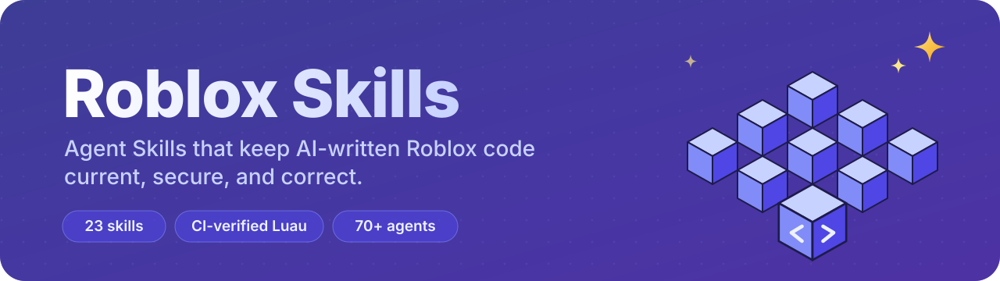

<p align="center"></p>

# Roblox Skills for AI Agents

[](https://github.com/EL4CTEO/roblox-skills/actions/workflows/validate.yml)
[](https://github.com/EL4CTEO/roblox-skills/releases)
[](https://www.npmjs.com/package/roblox-skills)
[](LICENSE)

23 [Agent Skills](https://agentskills.io) that keep AI-written Roblox code current, secure and correct. Works with Claude Code, Codex, Cursor, OpenCode, Gemini CLI, Copilot, Windsurf, Cline and [many more](docs/agents.md), plus Roblox Studio Assistant.

- **Current**: checked against the Roblox API reference (Studio 0.748, November 2026). No `wait()`, `BodyVelocity` or legacy `Chat`.
- **Verified**: CI type-checks every Luau example (strict mode, new type solver) and flags deprecated APIs weekly.
- **Light**: agents see ~150 tokens per skill and load the full skill only when needed.

## Install

**Claude Code**

```text
/plugin marketplace add EL4CTEO/roblox-skills
/plugin install roblox-skills@roblox-skills
```

**Any other agent** (needs Node.js)

```bash
npx skills add EL4CTEO/roblox-skills                            # choose agents interactively
npx skills add EL4CTEO/roblox-skills -a cursor -a windsurf -y   # or name them
```

**Without Node.js**

```bash
git clone https://github.com/EL4CTEO/roblox-skills.git && cd roblox-skills
./scripts/install.sh --project /path/to/game       # .agents/skills (Codex, Cursor, Gemini, Copilot, OpenCode, Amp, ...)
./scripts/install.sh --agent windsurf --global     # or claude, roo, kiro, goose, junie, qwen, ...
```

Every agent id and folder: [docs/agents.md](docs/agents.md). `--link` symlinks so `git pull` updates them. Windows: `scripts\install.ps1 -Agent windsurf`.

**npm**: `npm i -D roblox-skills` puts the skills in `node_modules/roblox-skills/skills`.

**Roblox Studio Assistant**: get `roblox-assistant-skills.zip` from the [latest release](https://github.com/EL4CTEO/roblox-skills/releases/latest) (or `python3 scripts/build-assistant.py`), then paste a file into **Assistant → Settings → Skills → Add**.

## Skills

| Area | Skills |
| --- | --- |
| Code and structure | `roblox-luau`, `roblox-architecture`, `roblox-networking`, `roblox-security`, `roblox-code-review` |
| Data and business | `roblox-data-stores`, `roblox-monetization`, `roblox-analytics-liveops`, `roblox-open-cloud` |
| Gameplay | `roblox-game-systems`, `roblox-characters-animation`, `roblox-npc-ai`, `roblox-physics`, `roblox-input` |
| Presentation | `roblox-ui`, `roblox-audio`, `roblox-world-building`, `roblox-text-chat` |
| Scale and workflow | `roblox-performance`, `roblox-teleport-matchmaking`, `roblox-tooling`, `roblox-testing`, `roblox-studio-mcp` |

For best results also connect your agent to Studio's MCP server ([`roblox-studio-mcp`](skills/roblox-studio-mcp/SKILL.md)) so it can playtest and verify its changes.

## Contributing

```bash
./scripts/setup-tools.sh && python3 scripts/validate.py
```

See [CONTRIBUTING.md](CONTRIBUTING.md). Corrections are welcome whenever Roblox changes an API.

## Shout-outs

Thanks to [fzsheik](https://github.com/fzsheik) for featuring roblox-skills in [GameDevTool's roundup of free AI tools for Roblox Studio](https://gamedevtool.com/ai-tools-for-roblox-studio/el4cteo-roblox-skills).

[MIT](LICENSE). This project is not affiliated with Roblox Corporation.
